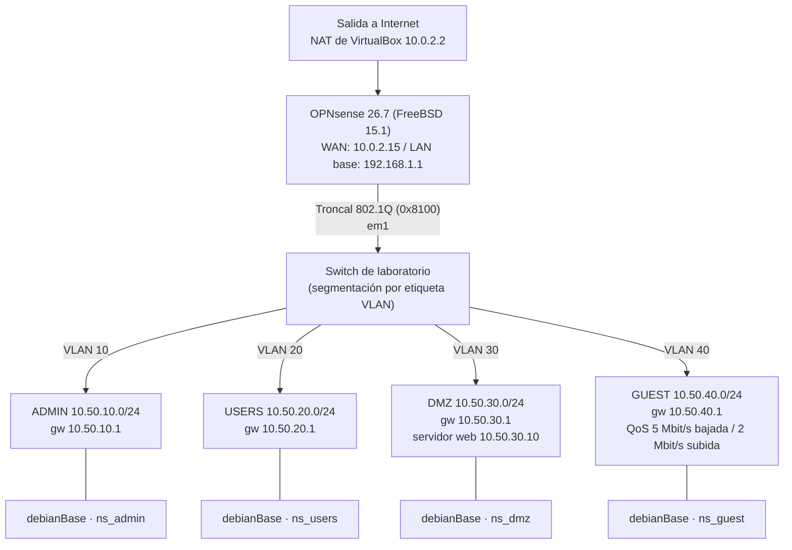

# Topología y direccionamiento del laboratorio

## Diagrama (laboratorio virtual)

Los cuatro clientes son *network namespaces* de systemd sobre una segunda máquina virtual (`debianBase`),
cada uno con su propio `/etc/netns/<ns>/resolv.conf` y unidades `sena-lab-vlans.service` /
`sena-dmz-web.service` para que sobrevivan a un reinicio.

## Direccionamiento

| Zona | VLAN | Red | Gateway | Cliente de prueba | Uso |
|---|---|---|---|---|---|
| ADMIN | 10 | 10.50.10.0/24 | 10.50.10.1 | `ns_admin` (lease .163) | Gestión del firewall e instructor |
| USERS | 20 | 10.50.20.0/24 | 10.50.20.1 | `ns_users` (lease .159) | Equipos de usuarios |
| DMZ | 30 | 10.50.30.0/24 | 10.50.30.1 | `ns_dmz` (lease .155) | Servidor web de pruebas `10.50.30.10` |
| GUEST | 40 | 10.50.40.0/24 | 10.50.40.1 | `ns_guest` (lease .151) | Invitados, con QoS y sin acceso interno |
| LAN base | — | 192.168.1.0/24 | 192.168.1.1 | acceso de rescate | Interfaz de gestión sin etiqueta |

## Reglas de política comprobadas

| Origen | Destino | Resultado esperado | Resultado observado |
|---|---|---|---|
| ADMIN | USERS / GUEST | Bloqueado | BLOQUEADO |
| ADMIN | DMZ:80 | Permitido | HTTP 200 |
| USERS | DMZ:80 y :443 | Permitido | HTTP 200 / HTTPS 200 |
| USERS | DMZ:22, ADMIN, GUEST | Bloqueado | BLOQUEADO |
| USERS | *(self)* 443, 22 y 53053 en todas las IP del firewall | Bloqueado | timeout en todos los intentos |
| DMZ | ADMIN, USERS, GUEST | Bloqueado | BLOQUEADO |
| GUEST | ADMIN, USERS, DMZ:80 | Bloqueado | BLOQUEADO |
| GUEST | Internet (HTTP) | Permitido | HTTP 200 |
| Todas las VLAN | 8.8.8.8 vía `10.50.X.1` → `10.0.2.2` | Sin bypass de NAT | Rutas y `traceroute -I` coherentes; `pfctl -sn` con NAT por VLAN |
