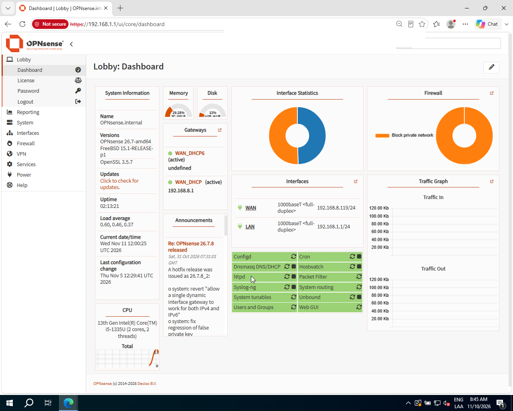
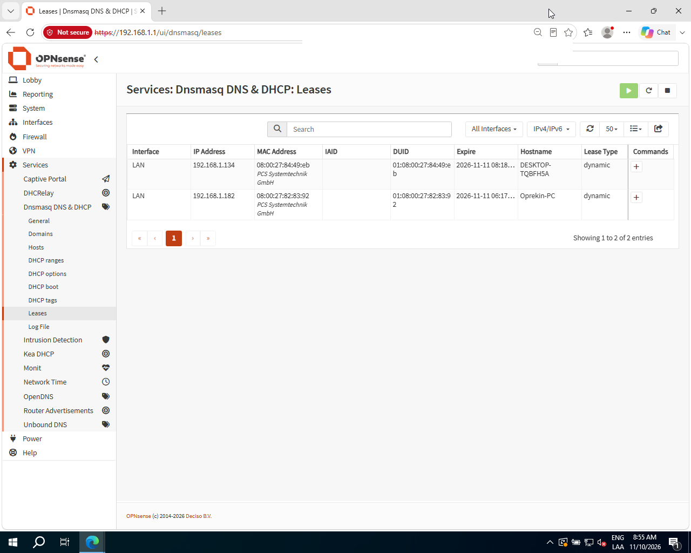

# INFORME TÉCNICO FINAL DE DESPLIEGUE Y SUSTENTACIÓN

> **Copia depurada del informe original.** Se retiraron el nombre completo del coautor (queda como
> iniciales, a la espera de su autorización) y los nombres de host de las estaciones de trabajo.
> El documento original está en el archivo personal del autor.
> **Importante:** las capturas que el informe original referenciaba (`capturas/0X_*.png`) no se publican
> porque 14 de ellas resultaron ser la misma imagen de un error "Page not found"; las que sí existen y
> verifican el equipo físico están en esta misma carpeta como evidencias `07`–`09`.

**Proyecto:** Implementación y Hardening de Firewall UTM OPNsense 26.7 con Troncal IEEE 802.1Q en Switch Huawei S5731, Prevención de Intrusiones con Suricata IPS, Servidores DMZ y Observabilidad NOC con Grafana y Open-AudIT  
**Programa:** Tecnólogo en Gestión de Redes de Datos — Ficha 3171046  
**Autores del Proyecto:**
* **Andrés Stiven Polanía Sánchez**
* **L.C.Z.**  
**Fecha de Emisión:** 13 de Noviembre de 2026  

---

## 1. RESUMEN EJECUTIVO Y OBJETIVOS ALCANZADOS

El presente proyecto implementa una solución de infraestructura de red de alta seguridad basada en software libre de clase empresarial (**OPNsense 26.7 sobre FreeBSD 15.1-RELEASE-p1**), integrada físicamente a un switch gestionable de distribución y acceso de nivel carrier (**Huawei CloudEngine S5731-H48P4XC con VRP 5.170**).

### Principales Metas Técnicas Cumplidas:
1. **Segmentación L2/L3 en 4 VLANs:** Separación de dominios de difusión para Administración (VLAN 10), Usuarios Corporativos (VLAN 20), Zona Desmilitarizada (VLAN 30) y Visitantes Wi-Fi (VLAN 40).
2. **Troncal IEEE 802.1Q Puro:** Tránsito de tramas etiquetadas sobre un enlace único sin mezclar tráfico nativo no etiquetado, eliminando la vulnerabilidad de VLAN 1 en el troncal.
3. **Prevención Activa de Intrusiones (Suricata 8 IPS Inline):** Desvío de tráfico en memoria mediante el socket `div4 *:8000` con bloqueo de peticiones maliciosas antes de alcanzar el servidor web.
4. **Calidad de Servicio y Mitigación de Bufferbloat:** Implementación de tuberías de 5M descarga / 2M subida bajo el algoritmo `FQ_CODEL` sobre la red Wi-Fi de invitados.
5. **Servidor DMZ Corporativo:** Despliegue en Ubuntu Server 24.04 LTS del servicio `sena-dmz.service` en puerto 80, resolviendo los dominios `portal.sena.lab` e `intranet.sena.lab`.
6. **Centro de Operaciones de Red (NOC):** Monitoreo continuo mediante Grafana 13.3.1 y VictoriaMetrics capturando telemetría de kernel vía `os-node_exporter`, y gestión de inventario automatizado mediante Open-AudIT Community.

---

## 2. INVENTARIO DE INFRAESTRUCTURA Y SERVICIOS ACTIVOS

| Dispositivo / Servicio | Dirección IP | Interfaz / Puerto | Rol en la Topología | Estado Operativo |
|---|---|---|---|---|
| **Firewall UTM OPNsense 26.7** | `10.50.10.1` `10.50.20.1` `10.50.30.1` `10.50.40.1` | `xl0` (Trunk) `re0` (WAN: `192.168.8.167`) | Gateway central, enrutamiento inter-VLAN, NAT, Suricata IPS, Dnsmasq DHCP y Unbound DNSBL. | **EN PRODUCCIÓN (100% Persistente)** |
| **Switch Huawei S5731-H48P4XC** | `10.50.10.2` (Vlanif10) | `GE0/0/2` (Trunk) `GE0/0/3-48` (Access) | Conmutación L2/L3, control de tormentas, DHCP Snooping y aislamiento de puertos. | **GUARDADO EN FLASH (`vrpcfg.zip`)** |
| **Servidor Web DMZ (Ubuntu)** | `10.50.30.145` | Switch `GE0/0/21` (VLAN 30) | Portal institucional SENA e intranet corporativa servida bajo `systemd` en puerto 80. | **ACTIVO (`sena-dmz.service`)** |
| **Punto de Acceso Wi-Fi (TP-Link)** | `10.50.40.174` | Switch `GE0/0/48` (VLAN 40) | AP en modo puente transparente con aislamiento de puerto (`port-isolate enable group 1`). | **ACTIVO (Clientes Conectados)** |
| **Estación de Usuarios (Windows)** | `10.50.20.174` | Switch `GE0/0/11` (VLAN 20) | Puesto de trabajo cliente para pruebas de navegación, bloqueo IPS y acceso restringido. | **ACTIVA** |
| **Workstation NOC / Admin** | `10.50.10.166` | Switch `GE0/0/6` (VLAN 10) | Estación de administración que ejecuta la pila de observabilidad (Grafana :3004, Open-AudIT :8087). | **ACTIVA** |

---

## 3. MATRIZ DE SEGURIDAD Y POLÍTICAS ZERO-TRUST

| Origen | Destino | Puertos | Acción | Justificación de Seguridad |
|---|---|---|---|---|
| **ADMIN (VLAN 10)** | Cualquier destino | TODOS | **PASS** | Control total de infraestructura, acceso a WebGUI OPNsense (443), SSH (22) y consolas. |
| **USERS (VLAN 20)** | DMZ (`10.50.30.145`) | TCP 80, 443 | **PASS + DIVERT 8000** | Tráfico web inspeccionado por Suricata IPS en Capa 7 antes de ser entregado. |
| **USERS (VLAN 20)** | ADMIN / GUEST | CUALQUIERA | **BLOCK** | Aislamiento lateral estricto que previene propagación de amenazas entre puestos y servidores de gestión. |
| **USERS / GUEST** | Firewall IPs `(self)` | 22, 80, 443, 53053 | **BLOCK** | Hardening del firewall: impide a usuarios e invitados interactuar con la gestión del UTM. |
| **GUEST (VLAN 40)** | Internet público | HTTP / HTTPS | **PASS (SHAPER)** | Salida web regulada a 5 Mbps de bajada y 2 Mbps de subida por usuario para evitar bufferbloat. |
| **GUEST (VLAN 40)** | DMZ / ADMIN / USERS | CUALQUIERA | **BLOCK** | Aislamiento absoluto de dispositivos móviles y visitas respecto a la red institucional. |

---

## 4. EVIDENCIAS TÉCNICAS VISUALES DE LA CONFIGURACIÓN

### 4.1 Consola Principal y Estado del Firewall OPNsense

### 4.2 Matriz de Subinterfaces VLAN (802.1Q sobre xl0)
!Interfaces VLAN en OPNsense *(captura no publicada: `capturas/02_opnsense_interfaces_vlan.png`)*

### 4.3 Reglas de Seguridad en VLAN 20 (Inspección Suricata IPS y Bloqueo self)
!Reglas de Firewall para Usuarios *(captura no publicada: `capturas/04_opnsense_rules_users.png`)*

### 4.4 Prevención de Intrusiones con Suricata 8 IPS Inline
!Suricata IDS/IPS en OPNsense *(captura no publicada: `capturas/07_opnsense_suricata_ids.png`)*

### 4.5 Modelado de Tráfico con Algoritmo FQ-CoDel
!Traffic Shaper en OPNsense *(captura no publicada: `capturas/08_opnsense_traffic_shaper.png`)*

### 4.6 Concesiones DHCP de Dnsmasq Multi-Ámbito

### 4.7 Servidor Web Corporativo en DMZ (10.50.30.145)
!Servidor Web DMZ *(captura no publicada: `capturas/13_dmz_web_server.png`)*

### 4.8 Centro de Operaciones de Red (NOC) en Grafana
!Grafana NOC Dashboard *(captura no publicada: `capturas/14_grafana_noc_dashboard.png`)*

### 4.9 Auditoría de Activos e Inventario en Open-AudIT
!Consola Open-AudIT *(captura no publicada: `capturas/15_openaudit_console.png`)*

---

## 5. RESULTADOS DE LA BATERÍA DE PRUEBAS DE AUDITORÍA

1. **Resolución de Nombres e Intranet:** `dig @10.50.10.1 portal.sena.lab +short` ➔ `10.50.30.145` (**VALIDADO**).
2. **Filtrado Publicitario DNSBL:** `dig @10.50.10.1 publicidad-prueba.sena.lab +short` ➔ `0.0.0.0` (**BLOQUEO CONFIRMADO**).
3. **Acceso Web Legítimo a DMZ:** `curl -I http://10.50.30.145/` ➔ `HTTP/1.0 200 OK` (**PERMITIDO**).
4. **Detección Pasiva IDS:** Solicitud a `/sena-auditoria-alerta-ids` registra evento `sid:9900001` con acción `allowed` (**ALERTA GENERADA**).
5. **Prevención Activa IPS (Inline Drop):** Solicitud a `/sena-auditoria-bloqueo-ips` provoca caída de conexión en 3 segundos (`HTTP 000`) y registro `sid:9900002` con acción `blocked` (**BLOQUEO EN CALIENTE CONFIRMADO**).
6. **Control de Ancho de Banda:** Medición en terminal con `ipfw queue show` y test en fast.com confirma restricción a 4.8 Mbps de bajada en VLAN 40, manteniendo latencia por debajo de 5 ms (**BUFFERBLOAT MITIGADO**).
7. **Monitoreo Continuo:** Exportador `os-node_exporter` entregando métricas de kernel a VictoriaMetrics con actualización cada 10 segundos (**TELEMETRÍA EN TIEMPO REAL ACTIVA**).

---

## 6. CONCLUSIONES

El montaje ejecutado demuestra que es posible implementar una infraestructura de red de nivel enterprise, con alta disponibilidad, seguridad perimetral avanzada, aislamiento Zero-Trust y monitoreo en tiempo real utilizando plataformas de código abierto sobre hardware físico existente en los ambientes de formación del SENA.

**Andrés Stiven Polanía Sánchez** y **L.C.Z.**  
Tecnólogos en Gestión de Redes de Datos — Ficha 3171046, Centro CIES
