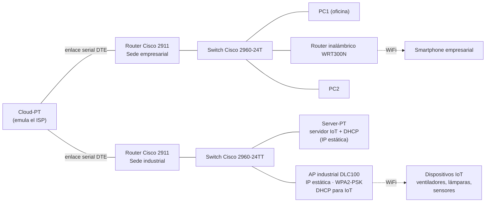
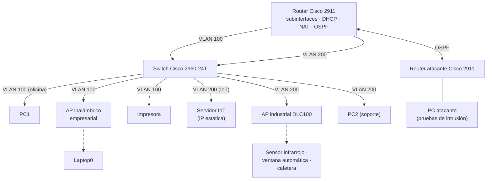

# Topologías de los dos escenarios (reconstrucción a partir del informe)

Diagramas redibujados por el autor del portafolio a partir de la descripción y las tablas del informe
grupal, para publicar sin exponer el documento original.

## Escenario 1 — Red WAN empresarial ↔ industrial

## Escenario 2 — Red LAN segmentada con atacante

## Endurecimiento aplicado (matriz del informe)

| Dispositivo | Modelo | Interfaces deshabilitadas | Motivo |
|---|---|---|---|
| Switch empresarial | Cisco 2960-24T | FastEthernet 0/2 – 0/24 | Evitar conexiones no autorizadas por puertos libres |
| Switch industrial | Cisco 2960-24TT | FastEthernet 0/3 – 0/24 | Reducir superficie de ataque en red IoT |
| Router empresarial | Cisco 2911 | GigabitEthernet 0/1 – 0/2, serial 0/3/1 | Deshabilitar interfaces sin función en la topología |
| Router industrial | Cisco 2911 | GigabitEthernet 0/1, serial 0/3/1 | Minimizar puertos abiertos |
| Switch segmentado (VLAN 100/200) | Cisco 2960-24T | FE 0/3–0/6 y 0/8–0/12 (VLAN 100); FE 0/16–0/24 (VLAN 200) | Aislar accesos no autorizados entre segmentos |
| Router segmentado | Cisco 2911 | GigabitEthernet 0/2 | Mantener solo las interfaces necesarias para enrutar VLAN |

Las tablas de direccionamiento IP y de enrutamiento del informe original no se reproducen aquí: sus IP
exactas están en el documento grupal, que se conserva privado.
